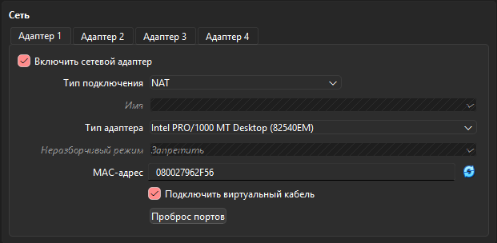
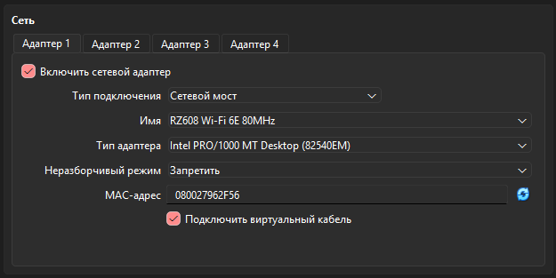
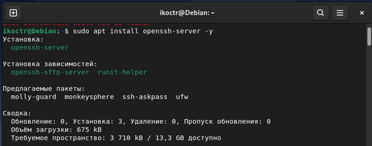
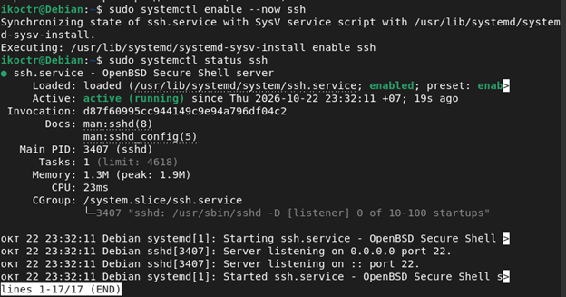
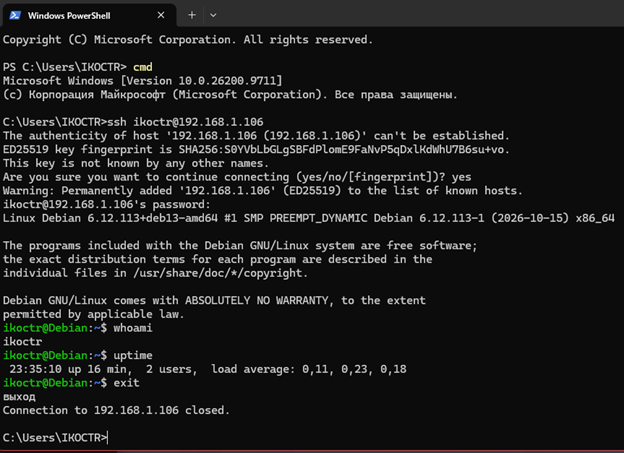
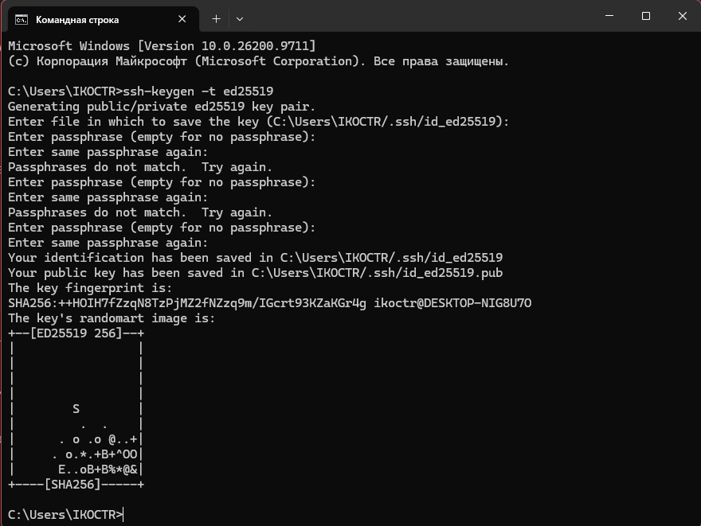
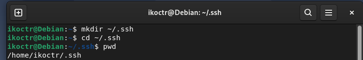
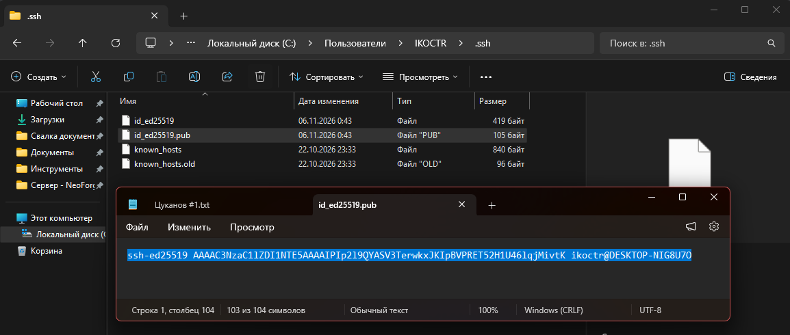
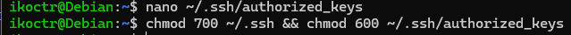

Выполнил: Шмаль Константин Иванович ИЭ-25

  
  # 1. Установка виртуальной машины:
  
 o	Создал новую виртуальную машину, выделив для нее 4 ГБ ОЗУ и 20 ГБ жесткого диска. 

  
  
  # 2. Установка Debian:
  
 o	Скачал ISO-образ Debian и установил его на виртуальную машину. 

  
 o	Настроил основные параметры 

  
  
  # 3.	Обновление системы:
  
 o	Настроил подключение к интернету через NAT и Bridged. 

  
  
  
  
 o	Выполнил обновление системы, используя sudo apt-get update и sudo apt-get upgrade. 

  
  
  
  # 4. Настройка SSH:
  
 o	Установил и настроил SSH-сервер. 

  
Установка SSH пакетов (-y : Согласие на все вопросы)

  
  
Установил службу SSH в авто-загрузку

  
 (--now : включить службу сейчас без перезагрузки) 

  
 (systemctl enable : авто-загрузка служб)

  
  
 o Подключился по SSH с основного ПК к ВМ 

  
По паролю:

  
  
По ключу:

  
Создал ключ SSH по типу шифрования : ed25519

  
  
Создал директорию .shh для ключа (проверил что дир. создалась корректно)

  
  
В файл с ключом, записал ключ-pub (замок) из хоста (который создал пару шагов назад)

  
Установил права доступа к .shh директории и файлу с ключом-pub (для корректной работы)

  
700 и 600 ?

  
1-ая цифра: Владелец файла

  
2-ая цифра: Группа в которую входит владелец файла

  
3-ая цифра: Остальные пользователи

  
  

