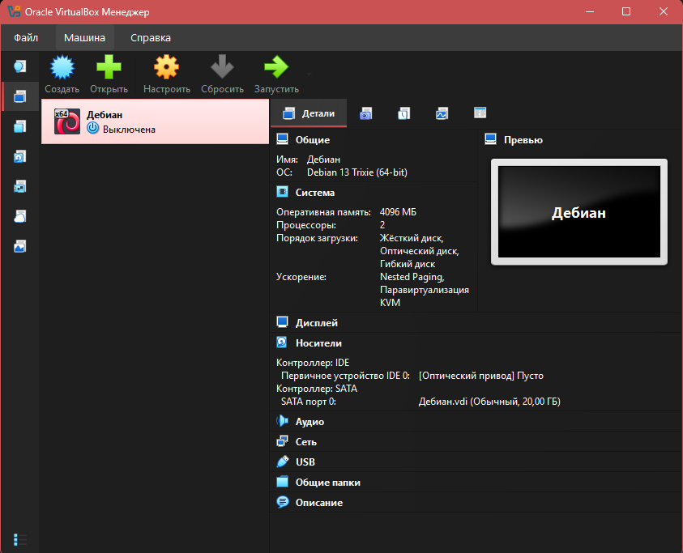
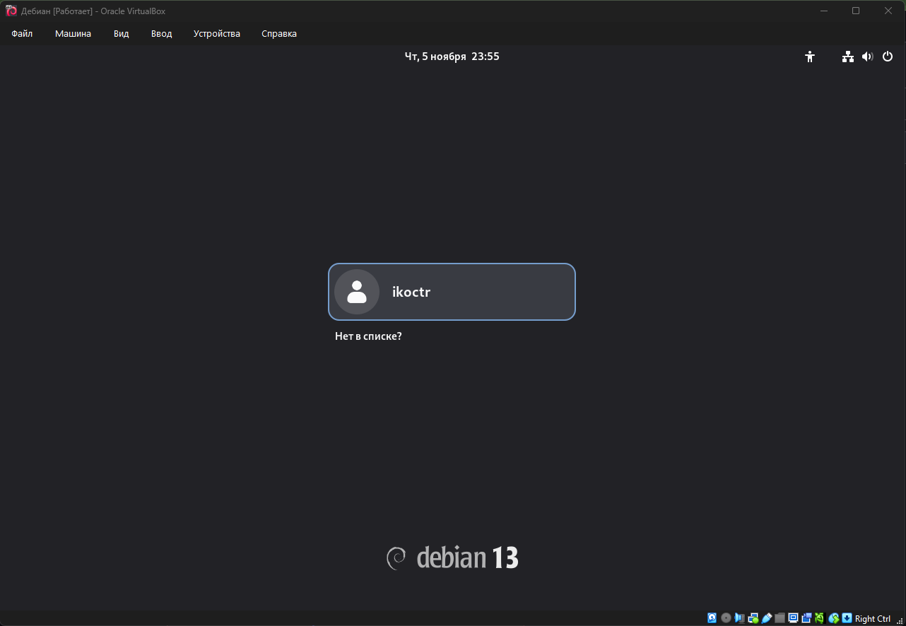
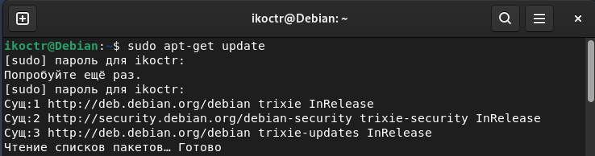
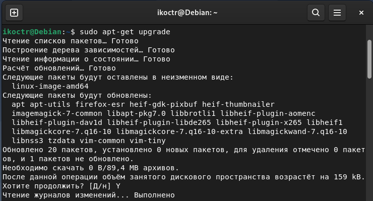

# Лабораторная #1 "Введение в виртуальные машины и установка Debian"

  Выполнил: Шмаль Константин Иванович ИЭ-25
  # 1. Установка виртуальной машины:
  
 o	Создал новую виртуальную машину, выделив для нее 4 ГБ ОЗУ и 20 ГБ жесткого диска. 

  
___
  # 2. Установка Debian:
  
 o	Скачал ISO-образ Debian и установил его на виртуальную машину. 

  
 o	Настроил основные параметры 

  
___
  # 3.	Обновление системы:
  
o	Выполнил обновление системы, используя sudo apt-get update и sudo apt-get upgrade.

  
  
___
  # 4. Настройка SSH:
  

